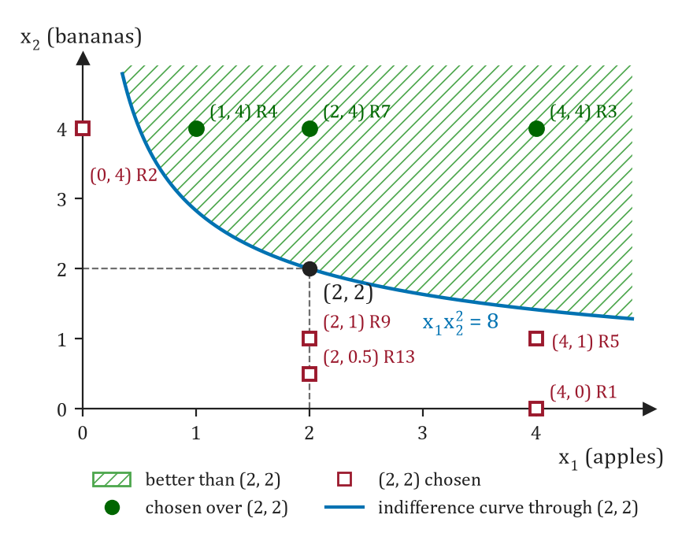

# EDMSI Assignment 1, Exercise 3 (b)(i)

Code for the figure in Exercise 3 (b)(i): the choices of participant 25 in the rounds with (2,2), and the indifference curve x₁x₂² = 8 (Cobb–Douglas, α = 1/3).

- `EDMSI - Assignment 1 - Ex3 - b-i.ipynb`: the notebook that draws the figure.
- `A1_Ex3b_figure.png`: the figure, as used in the submitted PDF.

To reproduce it, run all cells of the notebook (Python 3, numpy, matplotlib). The bundles are typed into cell 3 from the experiment data.

